# ARC Raiders: do lançamento ao Frozen Trail

**Vale a pena a Embark continuar investindo no ARC Raiders em 2027?** Análise de dados da trajetória do jogo, do lançamento (30/10/2025) até as vésperas da grande atualização Frozen Trail (08/10/2026), com diagnóstico, análise de 416,8 mil avaliações, segmentação de jogadores, curva de receita, projeções e uma recomendação de negócio.

> Análise fechada em 30/09/2026. Dados coletados até 25/09/2026. A revisão com os números do Frozen Trail está prevista na [seção 11](#11-limitações-e-próximos-passos).

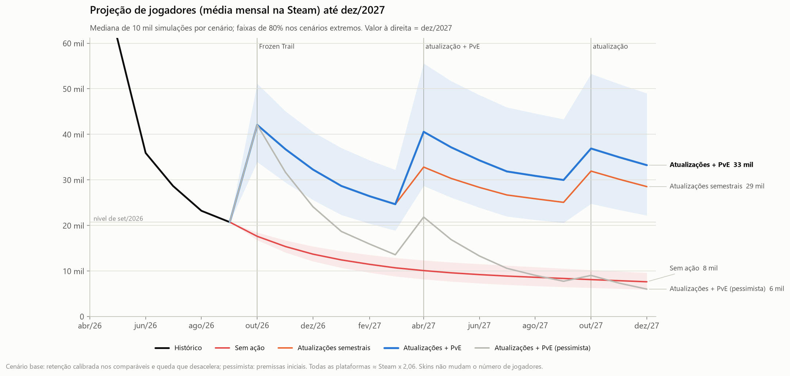

## Sumário

1. [Descrição](#1-descrição)
2. [Tecnologias e ferramentas](#2-tecnologias-e-ferramentas)
3. [Estrutura do projeto](#3-estrutura-do-projeto)
4. [Problema de negócio e objetivos](#4-problema-de-negócio-e-objetivos)
5. [Pipeline de soluções](#5-pipeline-de-soluções)
6. [Diagnóstico: da estreia à queda](#6-diagnóstico-da-estreia-à-queda)
7. [Modelo RFE](#7-modelo-rfe)
8. [Agrupamento](#8-agrupamento)
9. [Projeções e cenários](#9-projeções-e-cenários)
10. [Resultados financeiros e recomendação para 2027](#10-resultados-financeiros-e-recomendação-para-2027)
11. [Limitações e próximos passos](#11-limitações-e-próximos-passos)
12. [Execute este projeto em sua máquina local](#12-execute-este-projeto-em-sua-máquina-local)

---

## 1. Descrição

O ARC Raiders, extraction shooter da Embark Studios publicado pela Nexon, teve um dos maiores lançamentos de tiro dos últimos anos: 960 mil jogadores simultâneos em todas as plataformas, 16,3 milhões de unidades vendidas até junho de 2026 e cerca de US$ 660 milhões de receita estimada até setembro. Em 11 meses, porém, a média de jogadores na Steam caiu 92%, e a parcela de análises positivas foi de 88% para 51%.

Em maio de 2026, a Embark trocou as atualizações mensais por **duas grandes atualizações por ano**. A primeira, Frozen Trail, chega em 08/10/2026 com um mapa novo, progressão, skins de armas (Weapon Stencils) e, logo depois, um teste de **modo PvE**.

Este projeto reconstrói a trajetória do jogo com dados públicos, explica a queda, identifica quem saiu e por quê, estima a receita e projeta 2027 para responder a uma pergunta de negócio: manter ou não o investimento.

**Principais resultados**

| | |
|---|---|
| Posição na estreia | 2º maior pico entre 11 lançamentos de tiro comparáveis na Steam (465 mil), 2º em audiência na Twitch, 82% de análises positivas |
| Queda | −92% na média mensal de jogadores (nov/2025 → set/2026); 9% do melhor mês no 10º mês, entre as menores retenções do grupo |
| Reclamação nº 1 | Cheaters: de 9% para 43% das análises negativas; mencioná-los reduz em 28 p.p. a chance de recomendar o jogo |
| Quem saiu | O maior grupo que abandonou (30% dos autores de análises) **ainda recomenda o jogo (84%)**: saiu por falta de conteúdo, não por rejeição |
| Receita | ~US$ 660 mi até set/2026 (faixa de 80%: 619–701), ~1/3 da loja interna |
| 2027, cenário base | Atualizações semestrais + PvE + skins: ~33 mil jogadores na Steam em dez/2027 e US$ 127 mi de receita |
| **Recomendação** | **Manter o investimento em 2027, com ponto de revisão em fev/2027: seguir se jan/2027 tiver 19 mil jogadores ou mais na Steam** |

## 2. Tecnologias e ferramentas

- **Python 3.14**: pandas, NumPy, SciPy, statsmodels (regressão logística, efeitos marginais), scikit-learn (K-Means, silhueta), Matplotlib
- **Jupyter** (notebooks gerados por código e executados com `nbconvert`)
- **Coleta**: APIs públicas da Steam (análises, notícias), SteamCharts, exportações manuais do SteamDB e do TwitchTracker, Sensor Tower (conta gratuita), releases trimestrais da Nexon
- **Métodos**: estudo de evento, classificação de texto multilíngue por dicionário com validação manual, regressão logística, modelo RFE + K-Means, simulação de Monte Carlo, análise de sensibilidade
- Paleta de gráficos validada para daltonismo

## 3. Estrutura do projeto

```
arc-raiders-analysis/
├── data/
│   ├── raw/            dados coletados (as análises da Steam, 435 MB, ficam fora do git)
│   ├── external/       dados de terceiros e marcos oficiais (Nexon, Embark, TwitchTracker, SteamDB)
│   ├── interim/        tabelas tratadas (geradas pelo pipeline, fora do git)
│   ├── SOURCES.md      inventário de fontes com etiqueta de confiança
│   └── DICTIONARY.md   dicionário de dados
├── notebooks/          01 a 06, um por etapa de análise (+ scripts que os geram)
├── reports/
│   ├── figures/        todos os gráficos
│   └── metrics_*.json  números de cada etapa
└── src/
    ├── collect/        coletores (Steam, SteamCharts, notícias, publicações oficiais)
    ├── clean/          limpeza e validação
    ├── analysis/       diagnóstico, reclamações, segmentação, receita, projeções, decisão
    ├── viz/style.py    padrão visual dos gráficos
    └── pipeline.py     roda tudo na ordem
```

**Etiquetas de confiança** usadas em todo o projeto: **[O]** dado observado; **[E]** estimativa de terceiros; **[G]** referência de jogos do gênero; **[P]** premissa do projeto. Detalhes em [`data/SOURCES.md`](data/SOURCES.md).

## 4. Problema de negócio e objetivos

**Problema.** O ARC Raiders faturou muito rápido e perdeu a maior parte dos jogadores em menos de um ano. A Embark mudou a estratégia de atualizações e prepara um modo PvE e skins de armas. A decisão para 2027 é se vale manter uma equipe grande no jogo ou reduzi-lo a uma operação de manutenção.

**Objetivos**

1. Posicionar o lançamento frente aos FPS e extraction shooters consolidados.
2. Medir a queda de jogadores mês a mês e comparar a retenção com jogos parecidos.
3. Estimar a conversão da lista de desejos em vendas.
4. Medir o efeito das atualizações e dos patches de balanceamento.
5. Traçar o perfil dos jogadores.
6. Identificar as reclamações (cheaters, ratos, bugs, exploits, falta de PvE) e ligá-las à queda.
7. Segmentar os jogadores para saber quem saiu e por quê.
8. Estimar a curva de receita (vendas × loja interna).
9. Projetar o efeito das atualizações semestrais, do modo PvE e das skins de armas.
10. Recomendar manter ou não o investimento em 2027, com critérios verificáveis.

## 5. Pipeline de soluções

| Etapa | O que foi feito | Onde |
|---|---|---|
| 1. Estrutura | Repositório, ambiente e padrão visual | `src/viz/style.py` |
| 2. Coleta | 15 jogos no SteamCharts; **416.780 de 416.929 análises da Steam (99,96%)**; 77 anúncios oficiais; releases da Nexon; Sensor Tower; Twitch de 5 jogos (292 meses, com correção de um deslocamento de mês na fonte) | `src/collect/`, `data/SOURCES.md` |
| 3. Limpeza e validação | SteamCharts conferido com o SteamDB (diferença < 5% em todos os meses); dados pessoais dos autores removidos; linha do tempo de eventos | `src/clean/`, `data/DICTIONARY.md` |
| 4. Diagnóstico | 11 gráficos: posicionamento, curva, retenção, lista de desejos, estudo de evento, Twitch, perfil | [`01_diagnostico`](notebooks/01_diagnostico.ipynb) |
| 5. Reclamações | Dicionário multilíngue (12 idiomas), validação manual em amostra independente, regressões logísticas | [`02_reclamacoes`](notebooks/02_reclamacoes.ipynb) |
| 6. Segmentação | Modelo RFE + K-Means | [`03_segmentacao`](notebooks/03_segmentacao.ipynb) |
| 7. Receita | Monte Carlo calibrado nos números oficiais da Nexon | [`04_receita`](notebooks/04_receita.ipynb) |
| 8. Projeções | Calibração com 45 grandes atualizações de jogos comparáveis; 4 cenários × 2 variantes | [`05_projecoes`](notebooks/05_projecoes.ipynb) |
| 9. Decisão | Custo, retorno incremental, limite de decisão e quadro de indicadores | [`06_decisao`](notebooks/06_decisao.ipynb) |

---

## 6. Diagnóstico: da estreia à queda

### Uma estreia entre as maiores do gênero

2º maior pico de estreia na Steam entre 11 jogos comparáveis (465 mil, atrás só do Battlefield 6), 3º em análises positivas (82%) e 2º em horas assistidas na Twitch no lançamento (100 milhões). Fora da Steam, a Nexon reportou 960 mil jogadores simultâneos em jan/2026. Comparando os dois picos, **a Steam responde por cerca de 49% do público**.

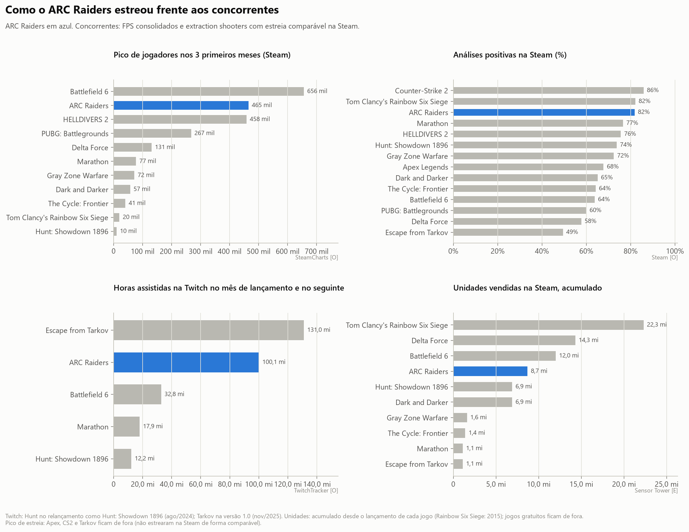

### A queda

A média mensal na Steam foi de 264 mil (nov/2025) para 21 mil (set/2026). Houve uma única alta, em jan/2026, e três quedas acima de 30% entre março e junho. Os FPS consolidados ficaram estáveis no mesmo período: a queda é do jogo, não do mercado.

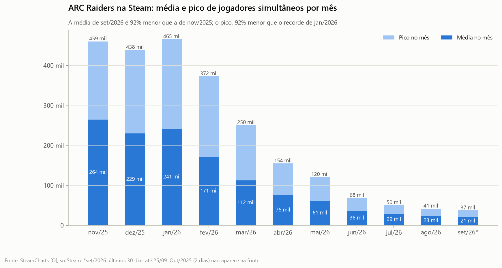
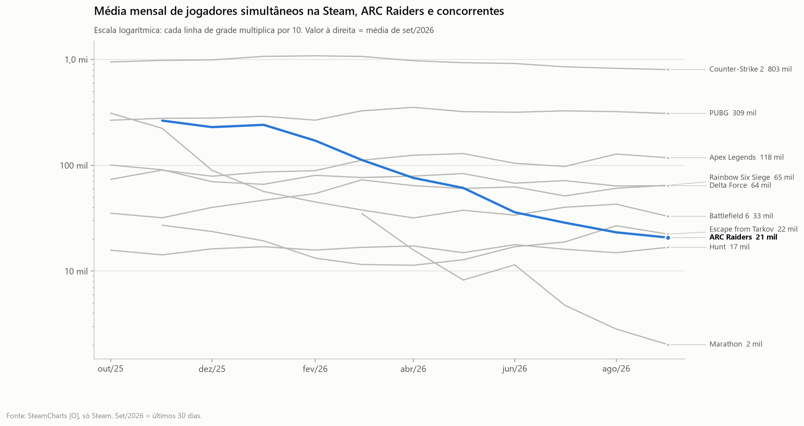

O paradoxo da retenção: o ARC Raiders foi o que **mais demorou para perder metade da base** (4 meses), mas chegou ao 10º mês com **9% do melhor mês**, à frente só de Gray Zone Warfare. Hunt, Rainbow Six e Delta Force mostram que jogos de tiro podem se estabilizar.

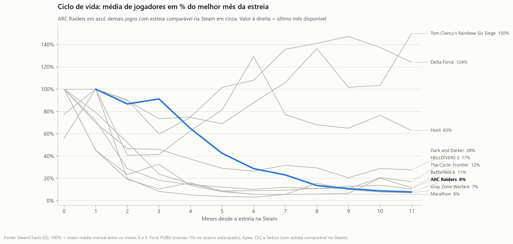
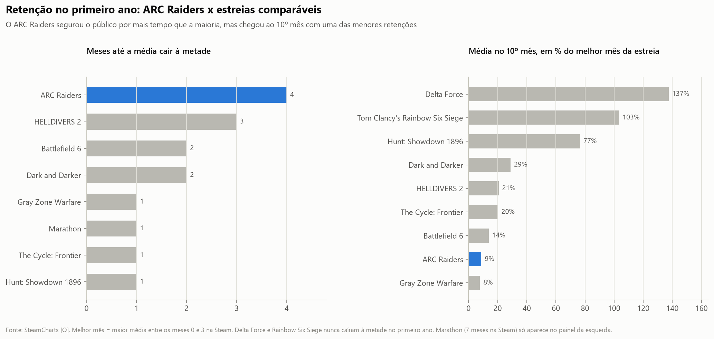

### Lista de desejos → vendas

O número de desejos no lançamento não é público; tratamos como cenário. Estimamos **3,7 mi de unidades na Steam nos 30 primeiros dias**, com um método (unidades por análise) validado contra os números oficiais: 5,35 mi pelo método contra 5,30 mi pelo oficial até dez/2025. Mesmo com 5 mi de desejos, a conversão seria de 75%, quase 3x a mediana da Steam (27%).

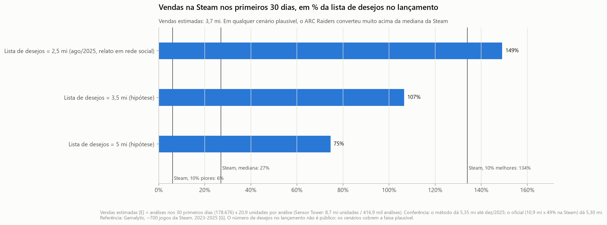

### Atualizações e patches

Estudo de evento sobre o pico diário: **atualizações de conteúdo ficaram em média +20% acima da tendência** de queda; **patches de balanceamento, −12%**. Depois de Riven Tides (28/04/2026), não houve mais atualização de conteúdo até o Frozen Trail.

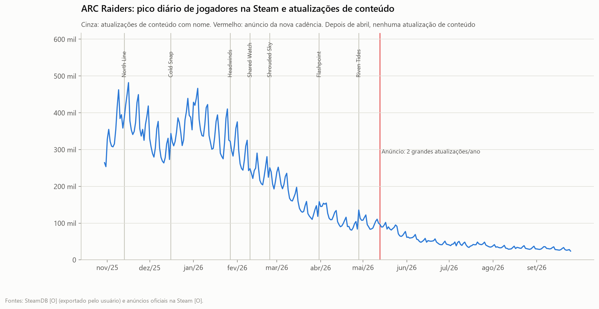
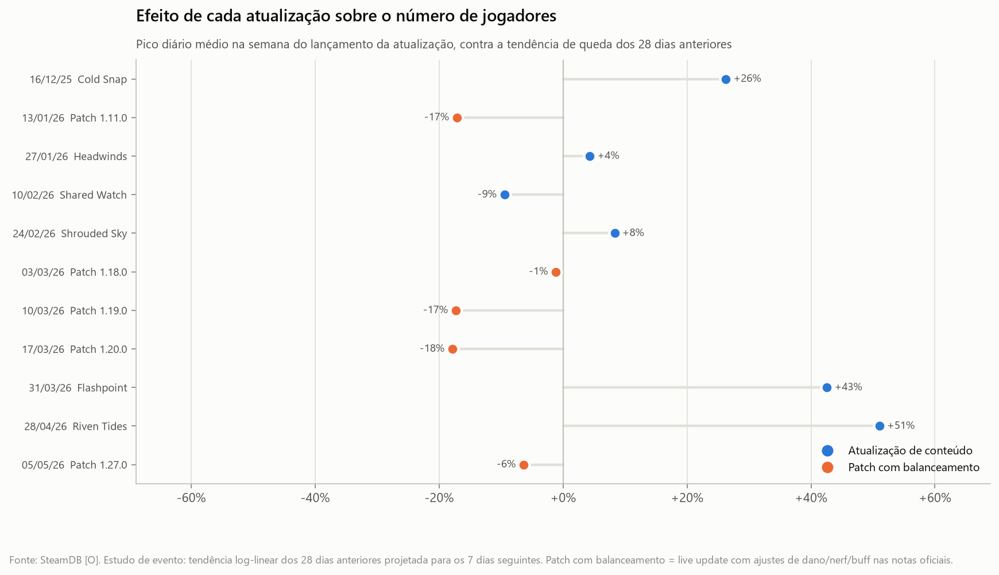

### Hype

A audiência na Twitch caiu antes e mais rápido que o número de jogadores: é um indicador antecedente.

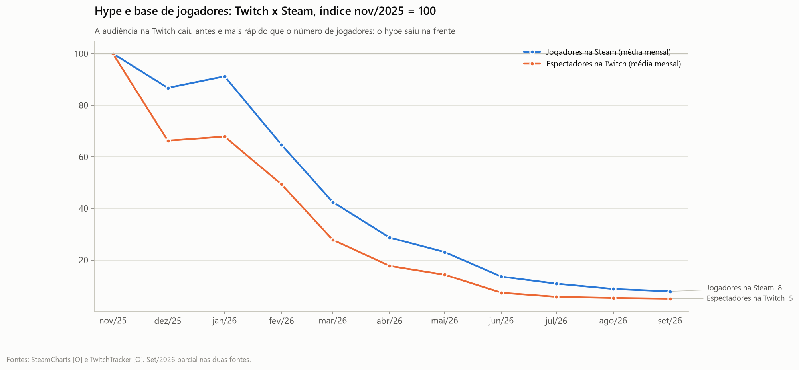

### Quem joga

60% das análises em inglês e 11% em russo; Steam ≈ 49% do público; segundo a Embark, 37% jogam de forma cooperativa e 51% querem um modo PvE; mediana de 138 horas jogadas por quem avaliou, mas só 14% jogaram nas duas semanas antes da coleta. Idade e gênero não são públicos: referências do gênero [G] indicam público de FPS ~93% masculino (Quantic Foundry, 2017) e concentrado entre jovens adultos (ESA, 2026).

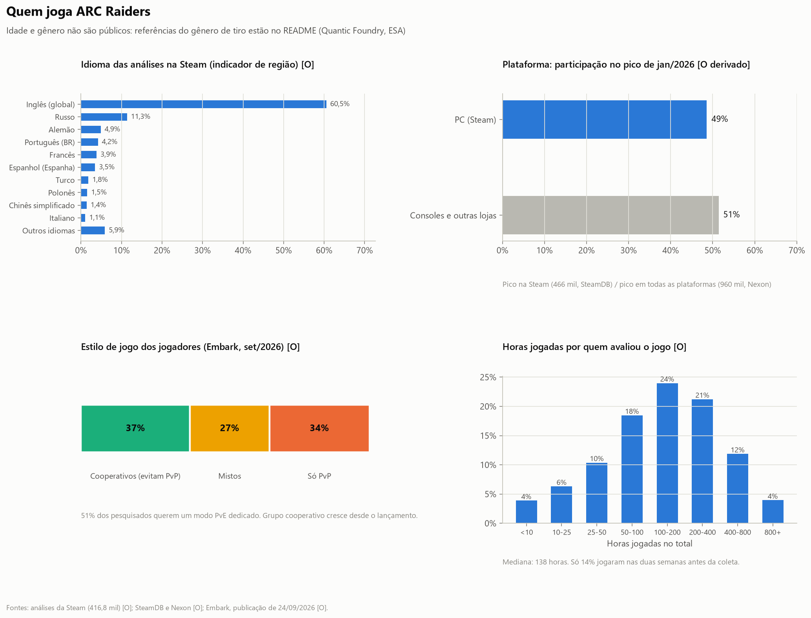

### Reclamações

Classificamos as análises em 8 temas com um dicionário em 12 idiomas. **Reclamação = análise negativa que menciona o tema** (nas positivas, os mesmos termos aparecem em elogios). A precisão foi medida numa **amostra independente de 220 análises lidas uma a uma: 90%**. O tema "falta de conteúdo" tem cobertura baixa (~46%) e está subestimado.

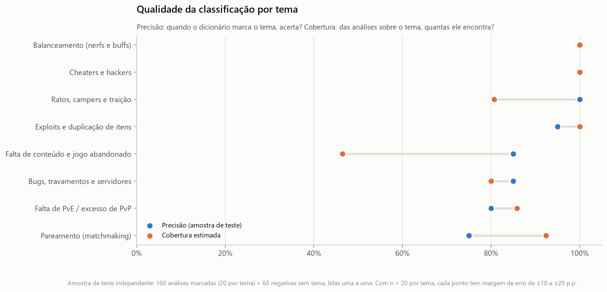

- **Cheaters são o problema nº 1 hoje**: de 9% para 43% das negativas; mencioná-los reduz em **28 p.p.** a chance de recomendar, quase o dobro de qualquer outro tema.
- **Balanceamento antecede as quedas**: único tema correlacionado com a queda de jogadores do mês seguinte (−0,55); nas semanas pós-patch, as reclamações de balanceamento sobem 60%.
- **Falta de PvE é constante** (~1 em 5 negativas) e vem de quem ainda joga.
- 85% dos autores de análises negativas já não jogavam, qualquer que fosse a queixa.

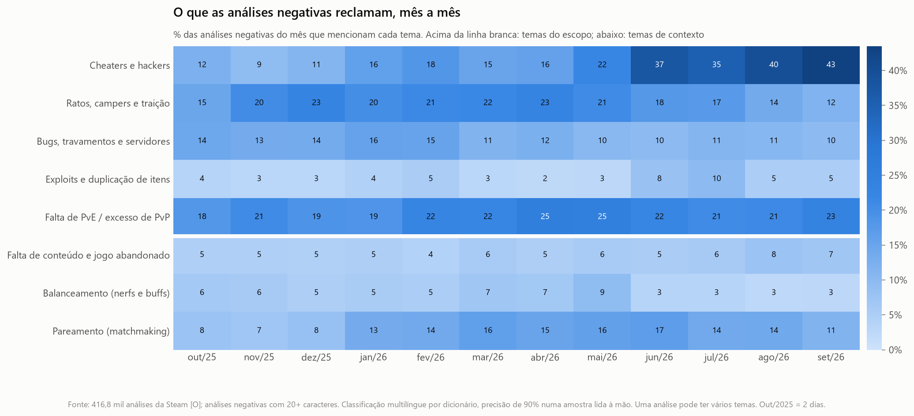
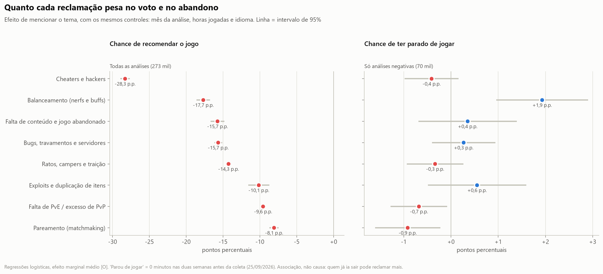
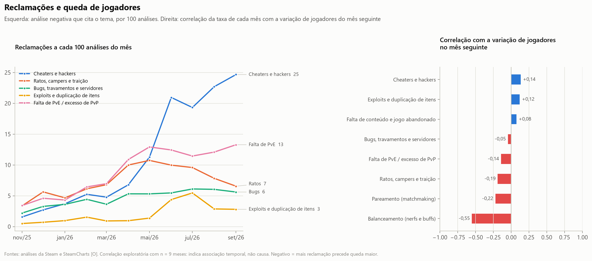

## 7. Modelo RFE

O projeto de referência segmenta clientes com **RFM** (Recência, Frequência, Valor monetário). Não há dados de compra por jogador, mas cada análise da Steam traz o perfil de jogo do autor. Adaptamos para **RFE**:

| | Indicador | Cálculo |
|---|---|---|
| **R** | Recência | dias entre a última sessão e a coleta |
| **F** | Frequência | horas por semana entre o lançamento e a última sessão |
| **E** | Engajamento | horas jogadas no total (no lugar do valor monetário) |

Cada autor recebe notas de 1 a 5 (quintis) em R, F e E. Medianas: 137 dias sem jogar, 6,3 h por semana, 138 h no total. Valores extremos (jogo aberto sem uso) foram limitados no percentil 99,9.

## 8. Agrupamento

K-Means sobre R, log(F) e log(E) padronizados. A silhueta é máxima em **k = 4**.

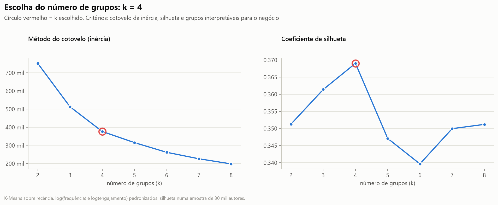

| Grupo | % | Perfil | Recomendam | O que pedem |
|---|---|---|---|---|
| **Veteranos ativos** | 27% | 11,5 h/semana, 435 h, 35% ativos nas últimas 2 semanas | 80% | Anti-cheat: 34% das queixas citam cheaters |
| **Veteranos que abandonaram** | 30% | 9,7 h/semana, pararam há ~7 meses (pico de saída em mar/2026) | **84%** | Conteúdo novo |
| **Casuais persistentes** | 27% | 3,3 h/semana, última sessão há ~2 meses | 86% | Modo PvE, menos PvP |
| **Desistiram cedo** | 16% | 22 h no total | 74% | — |

**O maior grupo que saiu gosta do jogo**: jogou intensamente, esgotou o conteúdo e parou no mês da maior queda. É o público mais recuperável para o Frozen Trail.

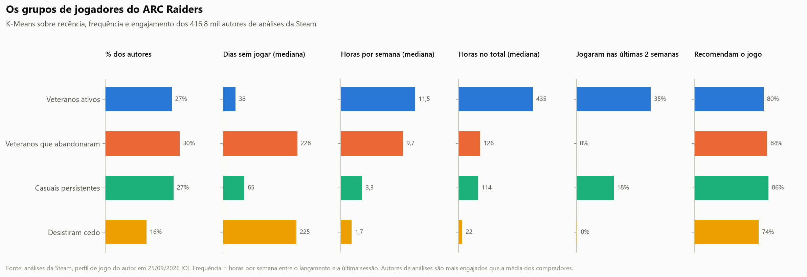
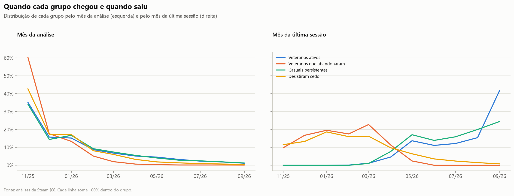
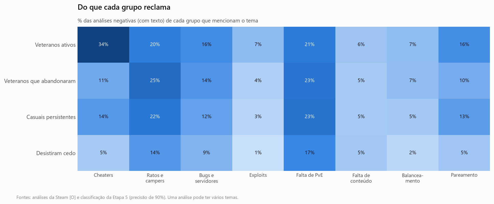

## 9. Projeções e cenários

### Calibração

Encontramos **45 grandes atualizações** em extraction shooters, Helldivers 2 e No Man's Sky desde 2019 (meses com alta de 20%+, conferidos nos anúncios oficiais): **alta mediana de +56%, e 3 meses depois a base segue 26% acima de antes**. O Tarkov tem picos de audiência na Twitch a cada 6 meses, há sete anos: é o modelo mais próximo da nova cadência.

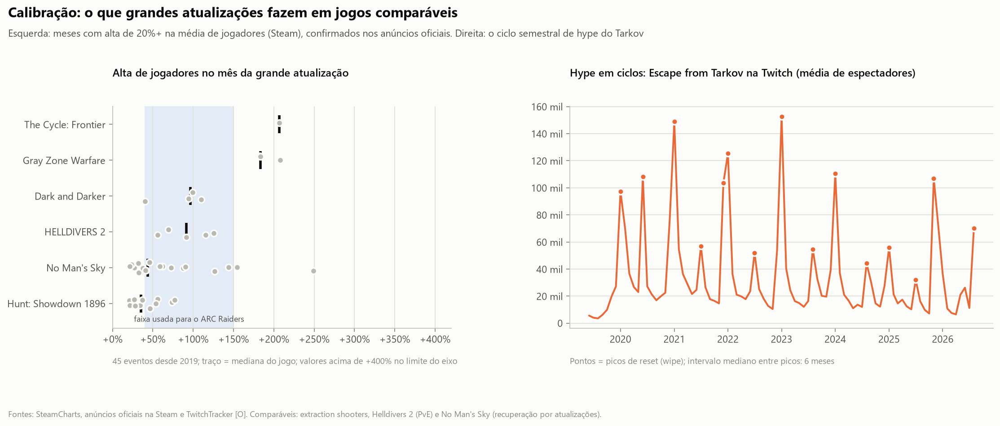

### Cenários (out/2026 a dez/2027, 10 mil simulações)

Duas variantes de premissas: **base** (retenção calibrada nos comparáveis e queda que desacelera) e **pessimista** (retenção de 20–45% e queda constante de 10–20% ao mês). As premissas, com faixa e etiqueta, estão no [notebook 05](notebooks/05_projecoes.ipynb).

| Cenário | Jogadores Steam dez/2027 (base) | Receita 2027 (base) | Receita 2027 (pessimista) |
|---|---|---|---|
| Sem ação | 7,6 mil | US$ 34 mi | US$ 19 mi |
| Atualizações semestrais | 28,5 mil | US$ 102 mi | US$ 40 mi |
| + modo PvE (abr/2027) | 33,2 mil | US$ 117 mi | US$ 45 mi |
| + skins de armas | 33,2 mil | **US$ 127 mi** (87–183) | US$ 49 mi |

- **Atualizações semestrais**: a curva vira um serrote; o Frozen Trail deve dobrar a média de outubro (~42 mil). O que separa base de pessimista é a **qualidade** da atualização: quanto da alta fica.
- **Modo PvE**: soma ~15% de jogadores em 2027, com ~45% da base no modo PvE. O ganho depende de uma premissa não calibrada: a volta de jogadores cooperativos no lançamento.
- **Skins de armas**: ~US$ 10 mi (~8% da receita), a projeção mais incerta, porque a skin pode ser perdida para quem te mata.

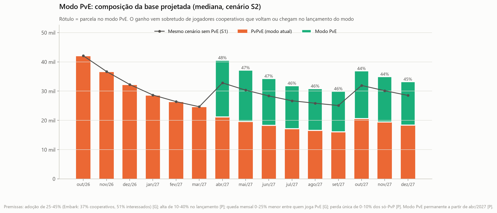
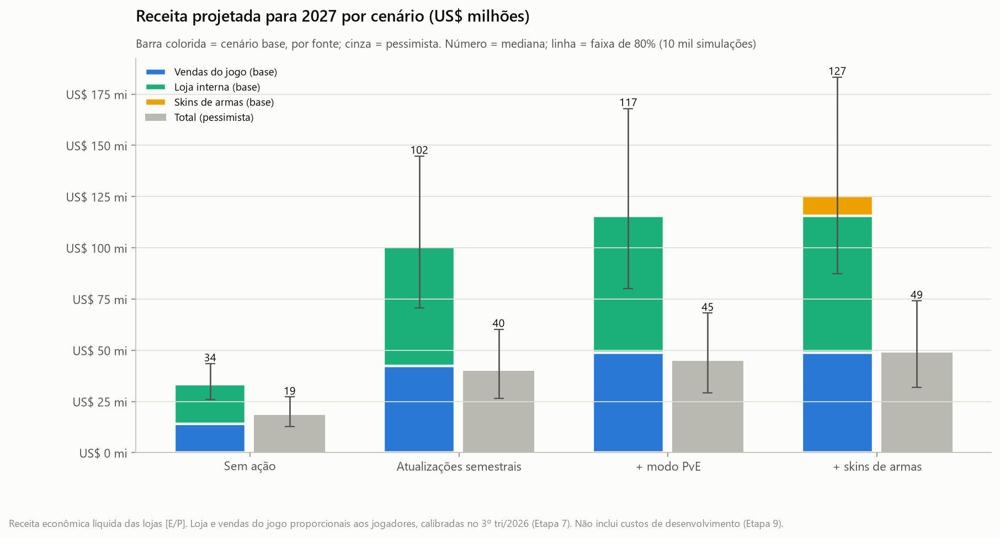
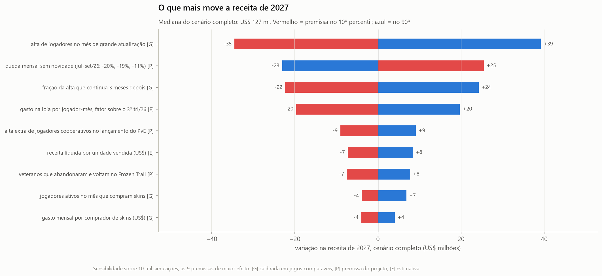

## 10. Resultados financeiros e recomendação para 2027

### Receita até hoje

A Nexon difere a receita das vendas na Steam (~60% das unidades), então a receita oficial de cada trimestre não corresponde às vendas do trimestre. Estimamos a **receita econômica** com um Monte Carlo calibrado nos números oficiais:

| Até jun/2026 | Mediana | Faixa de 80% |
|---|---|---|
| Receita econômica | US$ 638 mi | 600–677 |
| Vendas do jogo | US$ 432 mi | 360–504 |
| Loja interna | US$ 206 mi (32%) | 128–287 |
| **Até set/2026** | **US$ 660 mi** | 619–701 |

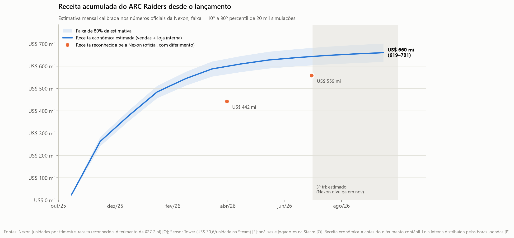
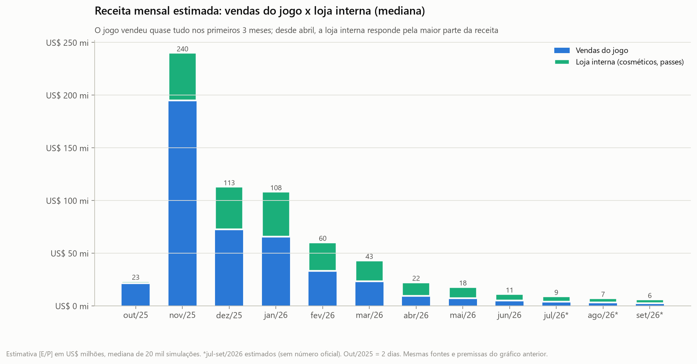

### A decisão

Mesmo sem conteúdo novo, uma equipe mínima segue recebendo a receita da base atual. A comparação é entre **investir** (150–250 pessoas: atualizações + PvE + skins) e **manutenção mínima** (30–60 pessoas). O custo não é público e entra como faixa [P].

| 2027 | Investir | Mínimo | Ganho de investir |
|---|---|---|---|
| Base | US$ 94 mi | US$ 26 mi | **+US$ 67 mi** (positivo em 100%) |
| Pessimista | US$ 16 mi | US$ 11 mi | +US$ 5 mi (positivo em 64%) |

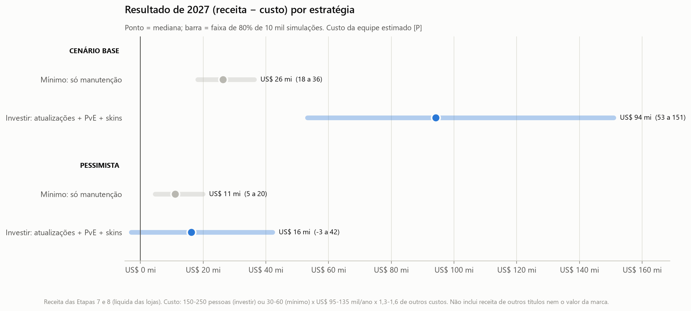

Base e pessimista começam iguais: o Frozen Trail deve levar out/2026 a ~42 mil nos dois. **A diferença aparece em jan/2027** (28,7 mil no base, 18,7 mil no pessimista). Acima de **19 mil jogadores na Steam em jan/2027**, investir dá ganho positivo em 70%+ das simulações.

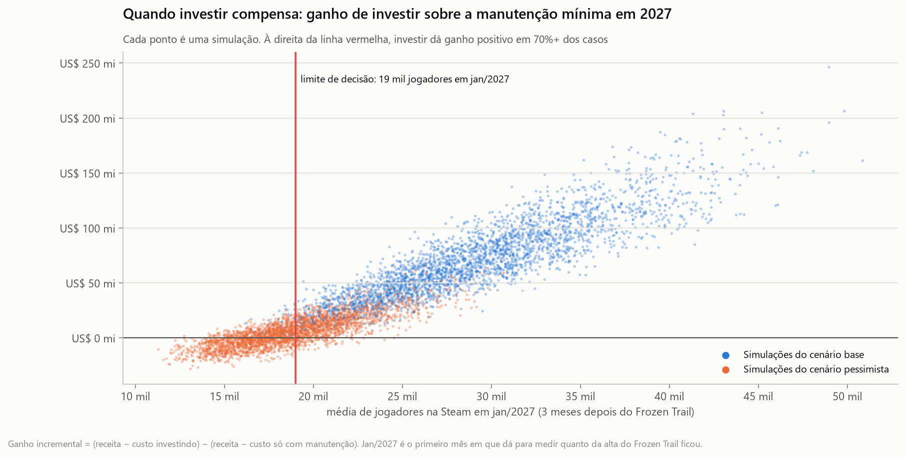

### Recomendação: manter o investimento em 2027, com revisão em fev/2027

**Por que manter:** ativo valioso (~US$ 660 mi em 11 meses); o público que saiu gosta do jogo; conteúdo novo funciona; aposta assimétrica (+US$ 67 mi no base contra perda máxima realista de ~US$ 10 mi).

**Condições**
1. Anti-cheat como prioridade nº 1 até o fim de 2026.
2. Congelar nerfs em armas populares.
3. Eventos menores a cada 4–6 semanas entre as grandes atualizações.
4. Modo PvE permanente em abr/2027 se a adoção no teste passar de 25%.
5. Skins como complemento, monitorando a conversão.

**Quadro de indicadores** (limites definidos antes do Frozen Trail)

| Indicador | Hoje | Limite | Quando |
|---|---|---|---|
| Média de jogadores na Steam em out/2026 | 21 mil (set) | ≥ 35 mil | nov/2026 |
| **Média de jogadores na Steam em jan/2027** | — | **≥ 19 mil** | fev/2027 |
| Retenção jan/out | — | ≥ 55% | fev/2027 |
| Análises positivas (out–dez/2026) | 51% | ≥ 65% | jan/2027 |
| Reclamações de cheaters por 100 análises | 25 | ≤ 15 | mensal |
| Adoção do PvE no teste | — | ≥ 25% | quando a Embark divulgar |

**Em fev/2027:** jan ≥ 19 mil e retenção ≥ 55% → plano completo de 2027. Abaixo disso → entregar a atualização de abril e reduzir a equipe para manutenção.

## 11. Limitações e próximos passos

**Limitações**
- **Só Steam nas séries mensais** (~49% do público); consoles entram pelos números oficiais da Nexon.
- **Receita por trimestre não é divulgada** antes de Q2/2026, e não se sabe se a Nexon registra vendas brutas ou líquidas da taxa das lojas: é a maior incerteza da divisão vendas × loja.
- **Autores de análises** (~5% das unidades na Steam) são mais engajados que a média: os grupos descrevem esse público.
- **Classificação de reclamações** por dicionário: precisão de 90%, mas cobertura de ~46% em "falta de conteúdo".
- **Correlações temporais** com 9 meses de dados não são conclusivas isoladamente; o peso vem da convergência de análises independentes.
- **Custo da equipe** é premissa; a Embark tinha ~350 pessoas em 2025, divididas com The Finals.
- **Fora do modelo**: possível lançamento na China, novas plataformas, sequência e sinergias com The Finals.

**Próximos passos**
- **Revisão pós-Frozen Trail** (nov/2026 e fev/2027): recoletar os dados, medir os indicadores da seção 10 e comparar projetado × real.
- Incorporar o resultado do teste de PvE (13–20/10/2026).
- Atualizar a receita com o release do 3º trimestre da Nexon (nov/2026).

## 12. Execute este projeto em sua máquina local

Pré-requisito: Python 3.12+ (testado no 3.14).

```bash
git clone https://github.com/zaprotas/arc-raiders-analysis.git
cd arc-raiders-analysis
python -m venv .venv
.venv\Scripts\activate          # Windows
# source .venv/bin/activate     # macOS / Linux
pip install -r requirements.txt
```

**Opção 1: refazer tudo, inclusive a coleta** (a coleta das 416 mil análises da Steam leva algumas horas):

```bash
python src/pipeline.py --coletar
```

**Opção 2: só as análises**, a partir dos dados brutos já coletados. O arquivo com as análises da Steam (435 MB) não está no repositório; rode antes `python src/collect/steam_reviews.py full 1808500 recent all`:

```bash
python src/pipeline.py
```

O pipeline gera as tabelas em `data/interim/`, os gráficos em `reports/figures/`, as métricas em `reports/metrics_*.json` e executa os seis notebooks. Sem a coleta, leva cerca de 15 minutos.

Dados exportados manualmente (SteamDB e TwitchTracker, que bloqueiam acesso automatizado) estão em `data/external/`, com os prints originais do TwitchTracker em `data/external/twitchtracker_prints/`.

---

*Projeto de portfólio de [Bruno de Oliveira Rodrigues](https://github.com/zaprotas). Dados públicos; ARC Raiders é marca da Embark Studios AB. Esta análise não tem relação com a Embark nem com a Nexon.*
